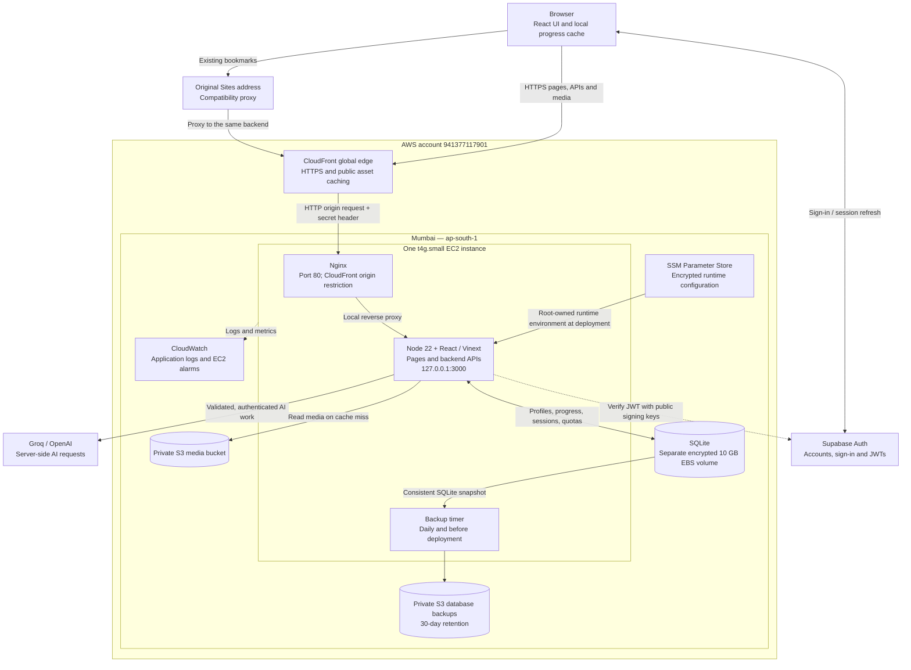
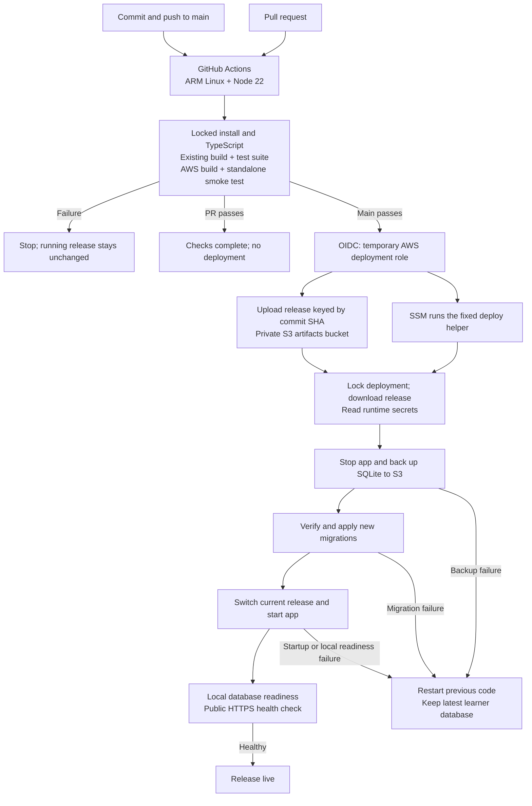

# LeseLaut system and deployment design

Architecture recorded on 23 October 2026 from the checked-in configuration and
the previously verified AWS cutover. A fresh AWS inventory request during this
documentation task was not executed because automatic approval review reached
its usage limit; this document is not a new live infrastructure audit.

- AWS account: `941377117901`
- Regional resources: Mumbai, `ap-south-1`; CloudFront is global.
- CloudFormation stack: `leselaut`
- Public endpoint: https://d19k6l47v6hw3.cloudfront.net
- Original address: https://leselaut-german.professor-ut7.chatgpt.site

## Website and request flow

The frontend and backend ship in **one application release on the same EC2
instance**. They are not separate Amplify and Lambda deployments. Public assets
can be cached at CloudFront; dynamic pages and authenticated APIs are not cached
by its default behavior. S3 is private: on a cache miss, media is read through the
application, rather than through a direct CloudFront-to-S3 origin.

Stories, grammar, vocabulary and book text are versioned with the source and
packaged into the application. Media includes assets packaged with the release
and 1,107 checksum-verified objects migrated from R2 to S3.

## Authentication and learner data

1. The browser signs in with Supabase and obtains an access token.
2. Protected API requests carry that token in an Authorization header.
3. The backend verifies its signature, issuer, audience, expiry and authenticated
   role using Supabase's public signing keys.
4. Database access uses the verified subject ID, with ownership checks and
   version checks where required by the feature.
5. Local progress is cached in the browser and synchronized for signed-in users.
   Browser-only progress remains scoped to its original website origin.

| Store | Contents | Authority |
| --- | --- | --- |
| Supabase Auth | Authentication identities and sessions | Sign-in identity |
| SQLite `users` | Profile, unique username, display name | Application profile |
| SQLite `user_progress` | Progress JSON per user and scope | Saved cloud progress |
| SQLite `tutor_sessions` | Practice history and versions | Saved AI practice |
| SQLite `tutor_quotas` | Usage per user and UTC date | Shared 20-request daily AI limit |
| Browser storage | Local progress and pending synchronization | Device-local state |
| S3 media | Migrated audio, timings and artwork | Migrated media objects |

The AI provider is selected on the server. Groq is preferred when its key is
configured; OpenAI is selected when the Groq key is absent. This is configuration
selection, not automatic failover after a provider error. Provider credentials
remain out of browser code and GitHub build inputs. Google OAuth is still pending
its client/provider setup.

Both public origins reach this same AWS database. The former D1 database is
frozen and retained; a failed proxy returns an error instead of writing to D1.

## GitHub to production

The deployment helper rolls back code after a stopped-phase failure when a
previous release exists. A public health failure detected later by GitHub marks
the workflow failed; it does not itself invoke another rollback. Database
migrations must remain additive and backward compatible because the database is
never rolled back over newer learner data.

GitHub uses short-lived OIDC credentials scoped to this repository's `main`
branch. It can upload releases and invoke the fixed deployment document, but
cannot retrieve runtime secrets. Deployments serialize and briefly interrupt
service during restart. Application pushes deploy automatically; infrastructure
and bootstrap changes require a separate reviewed update. Documentation-only
commits may explicitly skip CI. The last verified application pipeline passed
203 tests and deployed commit `649d6620b0fd57c1ce949c5540c90d3c9f2e038c`.

## Security and operations

| Concern | Current implementation |
| --- | --- |
| Browser transport | HTTPS at CloudFront; HTTP redirects to HTTPS |
| Origin transport | CloudFront to Nginx uses HTTP port 80; security group permits CloudFront origin-facing ranges and Nginx requires an origin token. TLS on this hop is not configured. |
| App process | Unprivileged systemd service, bound to loopback; protected filesystem |
| Administration | AWS Systems Manager; no SSH ingress |
| Runtime secrets | SSM SecureString, materialized to a root-only environment file |
| AWS access | IAM instance role for runtime; separate scoped OIDC role for CI |
| Data persistence | Encrypted EBS data volume separate from application releases and retained by the stack |
| Database backups | Daily and before deployment; private encrypted S3; 30-day retention; one restore independently verified during cutover |
| Logs | CloudWatch log group `/leselaut/application`, seven-day retention |
| Alarms | Sustained CPU and instance-status alarms; notification destinations are not configured |
| Release diagnosis | GitHub Actions logs, SSM command results and `/api/health` |

CloudFormation defines the AWS resources. The instance, data volume and buckets
have retention settings; deleting the stack is not a complete cleanup and may
leave billable resources. This architecture avoids an RDS instance, NAT gateway
and load balancer, but it is not guaranteed to cost zero.

## Availability and growth limits

- One application host and one attached database volume are failure points.
  There is no automatic application replica, multi-AZ database or failover.
- Backups enable recovery; they do not provide continuous availability. There is
  no continuous point-in-time recovery or measured recovery-time guarantee.
- A second application server cannot share the existing local SQLite file.
  Moving to a shared database is required before adding independent replicas.
- Production user capacity is not established by unit or concurrency tests.
  Measure latency, memory, CPU, database contention and AI provider limits before
  increasing traffic or choosing a scaling target.
- The health endpoint checks database readiness. It is not an independent uptime
  monitor and does not prove Supabase or the AI providers are healthy.

Implementation: [hosting guide](AWS_HOSTING.md), [CloudFormation source](../deploy/aws/stack.mjs),
[GitHub workflow](../.github/workflows/ci-deploy.yml), [release helper](../deploy/aws/release.sh).
