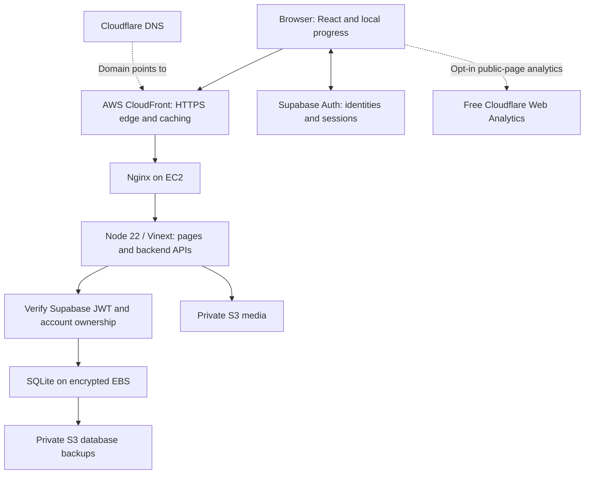

# LeseLaut development handoff

Prepared for continuing development with Claude Code on **14 November 2026**.
This document contains no credentials or private learner records.

## 1. Verified baseline

Before creating this documentation branch, local `main`, GitHub `main` and the
production health endpoint all matched:

`f61096cd83af13312c7f8489f429dbebef1cbb07`

That is PR #34, the free Cloudflare analytics release merged on 30 October 2026.
Its application deployment succeeded, with 283 tests, TypeScript checking, the
existing build, AWS standalone build and smoke checks. Those are recorded release
results, not a claim that the entire suite was rerun for this documentation audit.

Read-only checks on 14 November confirmed:

- `https://leselaut.com/api/health`: HTTP 200, status `ok`, release matching above.
- `/api/telemetry/config`: HTTP 200, paid AWS browser RUM disabled.
- Supabase's public settings: email and Google sign-in enabled; email confirmation
  required. No authentication identities or secret keys were read.
- AWS stack `leselaut`: `UPDATE_COMPLETE`; EC2 instance running, `t4g.small`, ARM64,
  region `ap-south-1`.
- GitHub main protection: required PR and strict/up-to-date `check-and-deploy`,
  admins included, force pushes/deletion disabled, zero required human approvals.
- Source UI flag `ACTIVE_LEARNING_ENABLED` is false. Local AI and RUM environment
  flags are not enabled. The last recorded production AI runtime setting is off;
  its encrypted secret payload was not retrieved for this audit.

This handoff is prepared on `codex/claude-code-handoff`. Check the documentation
PR's status before choosing a base for new feature work. Do not discard these
files while changing branches. The documentation handoff does not require an
application or infrastructure deployment.

## 2. Product and current behavior

LeseLaut is a German-learning website centered on reading, listening, vocabulary,
grammar, saved progress and daily practice. It remains a small reading beta;
teacher review and broader launch work were deferred.

| Area | Behavior and important implementation |
| --- | --- |
| Home `/` | Learning hub, Flashcards/Review, resumable plan, daily goals, streak and progress summaries |
| Stories `/stories` | A1–B2 reading library, narration, word highlighting, English support, quizzes and completion |
| Books `/books` | A1/A2/B1 readers, page audio, glosses, translations, bookmarks and word collection |
| Vocabulary `/vocabulary` | List/table with words, translations, progress, learned check marks, icon-only Review controls and pronunciation |
| Review | Shared saved-word deck and FSRS scheduling; `/review` redirects into Home's review view |
| Grammar `/grammar` | Reference, lessons and practice, with current/legacy progress compatibility |
| Account `/account` | Dynamic welcome/name, sign-in flows, sign-out and account deletion; no hardcoded account name |
| Active Learning | Writing, translation, speaking/photo workflows exist in source but are intentionally paused |
| Privacy/support | Privacy preferences, data export, deletion information and support details |

The shared top-right menu contains Account and the light/dark switch. The footer
keeps About, Privacy and Help & contact. Preserve accessibility labels on controls
even where visible text has been replaced by icons.

### Daily goals and shared progress

One newly completed story **or** five newly learned words completes the day.
Doing both earns one completed day, not two. Opening the site, saving a word for
Review, or rating an existing flashcard does not earn a streak day.

First-achievement timestamps are merged using the earliest valid achievement.
Toggling learned/unlearned or rereading an old story cannot manufacture a new
achievement. Existing/imported completions retain status without fabricated dates.
The first saved IANA timezone in `learning.daily` fixes the account's daily calendar
across devices/travel. Yesterday's streak remains available until today is missed.

Home and Review resolve the same word pool. Session warm-ups use bounded subsets,
so a session's review count can be smaller than the whole review backlog. A saved
session keeps its original level/duration when future preferences change.
See `docs/DAILY_LEARNING.md` and `docs/TODAY_LEARNING_PLAN.md`; the latter's old
D1/Sites deployment wording is historical.

## 3. Platforms and request flow



| Platform | Responsibility |
| --- | --- |
| GitHub `utkarshbaliyan/LearnGerman` | Committed source, PR review, branch protection, CI and deployment history |
| GitHub Actions | ARM Linux/Node 22 installation, tests, builds, checked release archive and main deployment |
| AWS CloudFormation `leselaut` | Infrastructure definition and resource configuration |
| AWS EC2 | One Amazon Linux ARM `t4g.small` in Mumbai; hosts frontend SSR and backend together |
| AWS CloudFront | Global HTTPS endpoint and cache in front of EC2 |
| Nginx/systemd | Reverse proxy and managed Node application service |
| AWS EBS/SQLite | Persistent application database, separate from replaceable code releases |
| AWS S3 | Private media, application release archives and SQLite backups |
| AWS SSM | Remote administration/deployment and encrypted runtime parameters; no SSH ingress required |
| Supabase Auth | Password/email/Google identities, JWTs, sessions, confirmation and recovery |
| AWS SES | Custom SMTP transport configured in Supabase for auth email; email templates have separate dashboard application steps |
| Cloudflare | Domain/DNS and free Web Analytics; not the current production compute/database host |

Production: `https://leselaut.com`, also `https://www.leselaut.com`.
The retained AWS distribution endpoint is `https://d19k6l47v6hw3.cloudfront.net`.
The old `chatgpt.site` address belongs to the historical Sites compatibility
setup; it is not the deployment target to use for future application releases.
Its availability was not rechecked for this handoff.

CloudFront terminates browser HTTPS. Its origin hop to Nginx is currently HTTP,
restricted by CloudFront origin-facing IP ranges and a separate origin header.
The Node server listens on loopback port 3000. This is one host, not a multi-AZ
cluster or a separate Amplify frontend/Lambda backend. SQLite cannot simply be
shared by adding independent EC2 application replicas.

## 4. Where code and data actually live

### On the laptop

The working directory is:

`/Users/utkarshbaliyan/Documents/LeseLaut`

| Path | Contents and role |
| --- | --- |
| `app/` | Next-style page routes, API routes, components, CSS and learning logic/data |
| `app/lib/` | Content catalogs/manifests, auth, progress merges, daily learning, vocabulary, books and feature flags |
| `app/api/` | Account, progress, material lookup, learning/tutor APIs, public health and telemetry config |
| `components/`, `hooks/`, `lib/` | Shared UI primitives and helpers |
| `content/` | Editorial source, audio plans/manifests, transcripts and generation inputs/assets |
| `public/` | Static assets, packaged narration/media, artwork, icons and analytics navigation guard |
| `db/` | Drizzle schema and database access boundary |
| `drizzle/` | Versioned SQL migrations; current tracked series runs from 0000 through 0005 |
| `deploy/aws/` | Infrastructure, SQLite/S3 adapters, provisioning, runtime configuration, release/backup helpers and operations |
| `deploy/supabase/emails/` | Maintained confirmation/recovery email template sources and application procedure |
| `deploy/cloudflare/analytics-public.json` | Public ingestion-only beacon configuration; not a Cloudflare administration credential |
| `.github/workflows/ci-deploy.yml` | Production CI/CD workflow |
| `scripts/` | Builds, smoke/health checks, media/content generation and upload utilities |
| `tests/` | Content, account ownership, progress merges, quotas, UI, privacy, migrations and deployment regression tests |
| `build/`, `worker/`, `.openai/hosting.json`, `platform-bindings.ts` | Vinext compatibility and retained local/legacy Cloudflare build support |
| `vendor/` | Vendored CSS/license material, not a primary editable application directory |
| `docs/` | Design, features, operations and historical verification; check dates before trusting statements |
| `package.json`, `package-lock.json` | npm commands and locked dependency graph |
| `vite.config.ts`, `next.config.ts` | Build-target selection, framework plugins, security headers and standalone configuration |
| `.env.local` | Ignored private local settings; not a complete copy of production runtime |
| `node_modules/` | Installed packages; do not edit as application source |
| `dist/` | Regenerable build output; AWS build writes `dist/standalone/` |
| `.wrangler/` | Local Miniflare/D1/R2 development state; can contain local test data |
| `.sites-runtime/` | Ignored project-local home, npm/tool caches and temporary build state |
| `.local-piper/` | Audio tooling, models, checkpoints, old release work and the actual Git directory — not all disposable |

### Unusual Git storage: preserve it

Root `.git` is a small text file containing a `gitdir:` pointer to:

`/Users/utkarshbaliyan/Documents/LeseLaut/.local-piper/project-git-local.nosync`

The Git configuration's `core.worktree` points back to the working source directory.
Git objects, branches, index and history live in that nested `.nosync` directory.
Do not delete it, replace the root `.git` file, or assume copying only visible
source folders preserves the repository.

An older registered worktree also exists at
`.local-piper/b2-release/publish-worktree.nosync`, on `codex/story-art-ui` at
`456721e` when inspected. It is historical work, not the current production base.
`git worktree list` reports the main metadata path in this setup; use
`git rev-parse --show-toplevel` to identify the working source root.

### Storage sizes and offloaded files

The 14 November `du` scan measured roughly 1.1 GB for `node_modules`, 455 MB for
`.sites-runtime` and 7.7 GB for `.local-piper`. The Git directory accounts for
about 890 MB inside that last total; `b2-release` accounts for about 1.9 GB.
Do not add those nested sizes to the parent total.

Git records approximately 221.2 MiB of `public/` files and 207.2 MiB of `content/`
files. Their local allocated sizes were much smaller. Sample media and the favicon
were explicitly marked macOS `compressed,dataless`: they are not all materialized
on the laptop. Reads and copies stalled during this audit, then some completed.
Use Finder to ensure required files are downloaded before large copies/builds.
Do not interpret an allocated size of zero as an empty or unneeded folder.

A `node_modules 2/` directory also exists with zero allocated size in the scan.
It is not the package installation selected by npm commands. No cleanup or folder
relocation was performed. If Documents file hydration keeps blocking development,
consider a separately authorized fresh checkout outside cloud-managed folders;
preserve private settings, local-only audio work and Git/worktree state first.

### In production, not on this laptop

- Supabase holds authentication identities/passwords, not the authoritative
  LeseLaut application-progress database.
- EC2's encrypted EBS volume holds `/var/lib/leselaut/leselaut.sqlite`.
- Main application tables include `users`, `user_progress`, `tutor_sessions`,
  `tutor_quotas`, `ai_provider_usage` and `account_deletions`.
- Progress is stored as account-owned JSON scopes, with browser caching and
  pending sync for stories, vocabulary, grammar, books and learning metadata.
- Private S3 holds additional audio/timing/art media, release bundles and daily
  database backups. Existing recorded backup expiry is 30 days.
- Browser storage belongs to each browser/device/origin. Guests stay local;
  signed-in learners synchronize through authenticated AWS APIs.
- The former production D1 database is frozen/retained from the AWS migration.
  Local `.wrangler` databases are development state, not production backups.

The GitHub repository is a source backup, not a backup of production learner
records, private credentials, browser-only progress or ignored local audio work.

## 5. Framework, local runtime and authentication

The source uses TypeScript, React 19 and Next-style App Router conventions, but
Vinext 0.0.50 on Vite 8 performs the actual development/build work. The locked
dependency graph also includes Next 16 types/APIs, Drizzle, Supabase JS and
`ts-fsrs`. Preserve `package-lock.json`; do not casually replace the stack with
standard Next/Vercel instructions or upgrade these coupled packages together.

The normal `npm run dev` path uses the Cloudflare Vite plugin, local Miniflare
bindings and project-local state. There is intentionally no `wrangler.jsonc` or
`wrangler.toml`; configuration is assembled in `vite.config.ts` using
`.openai/hosting.json`. Ordinary development does not require publishing to Sites.

For `LESELAUT_BUILD_TARGET=aws`, a Vite loader replaces `platform-bindings.ts`
with `deploy/aws/runtime.mjs`. That supplies the SQLite-compatible DB binding and
private S3 media binding. Thus names such as `getD1()` in `db/index.ts` do not mean
the production application still stores data in Cloudflare D1.

Supabase signs the browser in, stores/refreshes its session and issues access
tokens. Authenticated API requests send a bearer token; the backend checks the
Supabase signing keys, issuer, audience, expiry and role, then enforces ownership.
Public client configuration in source is not the server administrative secret.
Local OAuth/confirmation/recovery callbacks need the appropriate local URL in
Supabase's redirect allowlist. Use the actual development-server URL; preserve
production callbacks and email-confirmation protections when adjusting local setup.

Local/staging preview still uses the configured real Supabase project unless
explicitly separated. Signing up can create a real authentication identity;
administrative deletion can affect that identity. Use disposable test accounts,
not the owner's normal account, for signup/recovery/deletion testing. Staging
safety flags and deletion allowlisting exist in `app/lib/staging-safety.mjs`.

The ignored `.env.local` currently has variable names `GROQ_VISION_MODEL`,
`SUPABASE_SECRET_KEY`, `LESELAUT_AI_ENABLED` and `LESELAUT_RUM_ENABLED`.
Their credential values are deliberately omitted. `.env.example` lists historical
provider examples and is not a complete current production configuration.

AWS runtime secrets are stored in SSM SecureString `/leselaut/runtime` and
materialized on EC2 at `/etc/leselaut/runtime.env` for systemd. Auth email SMTP
credentials have their own encrypted source `/leselaut/ses-smtp`. Do not dump
those files/parameters or copy production runtime into GitHub/Claude chat.

## 6. Local commands and Claude Code startup

Claude Code was already installed at `/Users/utkarshbaliyan/.local/bin/claude`;
`claude --version` returned 2.1.168 during this audit. Its login/subscription status
was not inspected. No Claude installation or account setting was changed.

```sh
cd /Users/utkarshbaliyan/Documents/LeseLaut
claude
```

Claude Code reads the root `CLAUDE.md` as project instructions. Ask it to read
this longer handoff before implementing a feature. The application's continuation
depends on source, private local settings and cloud access, not the previous chat
being present in Claude's session.

For development:

```sh
git status --short --branch
git rev-parse --show-toplevel
node --version
npm --version

# Only if packages are absent or the lockfile changed:
npm ci --no-audit --no-fund

npm run dev
```

Use the URL printed by Vite; do not assume an old preview port is still running.
CI and production use Node 22; package engines require >=22.13.0. This Mac currently
reports Node 26.10.0/npm 11.19.1. Prefer Node 22 for reproducing CI failures.
The Linux-oriented `install:ci` helper uses tooling not universally present on
macOS; ordinary locked `npm ci` is the straightforward local install path.

Required checks for application changes:

```sh
npx tsc --noEmit
npm test
npm run build:aws
node scripts/smoke-aws.mjs
```

`npm test` builds the retained Cloudflare target and runs the bounded full suite.
`npm run test:checks` runs tests without first producing a fresh build; some tests
expect build artifacts, so it is not a substitute for the complete workflow.
The AWS smoke script creates a disposable local SQLite database. It does not
point at the production learner database. `npm run start` invokes Vinext's start
command; do not assume it starts/configures `dist/standalone/server.js` for AWS.

Optional read-only deployment verification, replacing the placeholder with the
expected checked main commit:

```sh
node scripts/verify-public.mjs https://leselaut.com EXPECTED_40_CHARACTER_COMMIT
```

Use targeted tests for actual changes and the required CI suite before merge.
Documentation-only handoffs do not require rebuilding the application locally.

## 7. GitHub to production

1. Make a scoped feature branch and edit source; preserve unrelated local work.
2. Review the diff, run relevant checks, commit and push a PR to `main`.
3. Required `check-and-deploy` installs the lockfile on ARM Linux/Node 22, checks
   TypeScript, builds/runs all tests, then builds/smoke-tests the AWS artifact.
4. PRs stop after checks. Main protection requires an up-to-date passing PR,
   including for admins. It does not require an independent human approval.
5. Merging to `main` repeats checks. A separate deploy job downloads the archive
   produced by that same successful run; it does not rebuild unchecked code.
6. GitHub OIDC obtains a short-lived, main-scoped AWS deployment role. The job
   uploads to private S3 and invokes the fixed SSM deployment document.
7. The EC2 helper serializes rollout, backs up SQLite, applies verified migrations,
   switches the current code release and checks readiness/public endpoints.
8. Production health must show the checked commit. Public probes check headers,
   assets, account/auth boundaries, disabled paid RUM and audio seeking. GitHub
   records success/failure in Actions and Deployments.

Code lives in `/opt/leselaut/releases/<commit>`; `/opt/leselaut/current` points to
the active release. The learner database is outside those directories. A failed
server-side rollout restarts the previous code while keeping the latest database.
Never automatically restore old learner data as an application rollback.

Migrations must be additive/backward compatible. Database restores, purges and
account deletion tests against real identities require separate owner approval.
A later independent GitHub public-probe failure reports failure; it does not
prove that another automatic rollback occurred.

The root-owned `/usr/local/bin/leselaut-deploy` is installed separately. Merging
`deploy/aws/release.sh` alone does not update it. CloudFormation, installed helper,
runtime-secret and Supabase-dashboard changes require separate reviewed work.
The single server has a brief restart interruption; this is not zero-downtime HA.

## 8. Analytics, design and safe future work

Cloudflare Web Analytics uses the existing preferences UI and a provider-specific
consent key. Guests and signed-in visitors can contribute public-page visits and
views after opting in. Existing opt-outs, Do Not Track and Global Privacy Control
are respected. Reports do not provide deduplicated people, live signed-in account
counts or custom lesson-completion events. The October test counts were validation
traffic; they are not a current audience measurement.

Keep Cloudflare **Enable with JS Snippet installation**, not automatic injection.
`public/analytics-boundary.js` isolates private account/auth/AI routes and blocks
analytics connections before opt-out reload. Do not replace it with a globally
loaded SDK and assume removing a script unloads its listeners. Paid AWS RUM stays
off; old CloudWatch browser widgets can therefore be empty even when visitors exist.

`app/platform-colours.css` owns shared light/dark tokens. Butter is used for
Home/Review/About, sage for Stories/Account/Privacy/Help, peach for Books, sky for
Vocabulary and lilac for Grammar/Active Learning. Semantic learned/review/new
colors stay consistent. `app/responsive.css` follows the palette import. Preserve
phone layouts, keyboard/zoom behavior, accessible names and readable contrast.
The responsive audit UI is development-only and must not appear in production.

Known Vinext compatibility fixes matter: both `/` and `/:path*` header rules are
required in `next.config.ts`, and `build/viewport-vite-plugin.ts` preserves safe
area/keyboard viewport metadata with the locked framework version.

Keep stable content IDs, bookmarks, vocabulary aliases, FSRS schedules, account
switch cleanup, tombstones, offline recovery and progress merge semantics. Keep
AAC narration and HTTP byte ranges working in Safari/iPhone. Generation/upload
scripts can call providers or modify media; do not run them as generic setup.

AI code exists but is deliberately paused. The UI flag and server provider gate
are separate controls. Enabling a page alone is not enough to resume safely, and
provider presence is not automatic paid-service authorization. Review costs and
the owner's requested limits before any activation. Existing AWS hosting can still
incur charges; historical trial/pricing notes are not proof of today's bill.

## 9. Reading order and known stale documentation

1. `CLAUDE.md` and this handoff.
2. `package.json`, `vite.config.ts`, `next.config.ts`, `platform-bindings.ts`.
3. `docs/AWS_HOSTING.md` and `.github/workflows/ci-deploy.yml`.
4. `docs/AWS_SYSTEM_DESIGN.md`, `db/schema.ts`, AWS runtime/SQLite adapters.
5. `docs/DAILY_LEARNING.md`, `docs/CLOUDFLARE_ANALYTICS.md`, `docs/DESIGN_SYSTEM.md`,
   `docs/SECURITY_HARDENING.md` and the relevant feature source/tests.
6. `docs/RESPONSIVE_QA.md`, `docs/RELEASE_VERIFICATION.md` and
   `docs/LAUNCH_READINESS.md` for dated verification and remaining work.

The September `docs/PROJECT-STRUCTURE-AND-PERFORMANCE.md` still names
`/Users/utkarshbaliyan/Documents/ChatGPT/LeseLaut`, a live Sites/D1 deployment and
old file/test counts. Those are historical, not current setup instructions.
README's later feature milestones and several learning docs also contain old
Sites/D1 references. `docs/AWS_SYSTEM_DESIGN.md` says Google OAuth was pending;
later launch records document successful Google signup. Verify provider settings
rather than using the earlier sentence as a current limitation. Design docs saying
the palette is imported last predate the final responsive override import.

Prefer fresh source, health, protected workflow and cloud configuration over an
older narrative. Never solve a documentation mismatch by redeploying the legacy
host, overwriting a populated database, deleting progress or enabling AI.

## 10. Open maintenance work at the handoff date

GitHub also has unmerged Dependabot PRs. Their existence does not mean those
versions are running in production, and some proposed versions are already in
current main through other changes. Check the actual diff and current lockfile
before choosing one as development work; do not merge the whole queue blindly.

| PR | Proposal |
| --- | --- |
| #36 | Compatible dependency group across 28 updates |
| #21 | `@types/node` from the Node 22 series to the Node 26 series |
| #19 | `satori` and Vinext updates |
| #18 / #17 | GitHub checkout/setup-node action updates |
| #16 / #15 / #14 | Next, fast-uri and Zod updates |

These were only inventoried, not reviewed or merged for this handoff. In
particular, align Node types with the intended runtime and preserve the locked
Vinext compatibility fixes until replacement behavior has been verified.
This handoff itself is [PR #37](https://github.com/utkarshbaliyan/LearnGerman/pull/37).

Official Claude Code references:
[project instructions](https://code.claude.com/docs/en/memory) and
[starting a session](https://code.claude.com/docs/en/quickstart).
